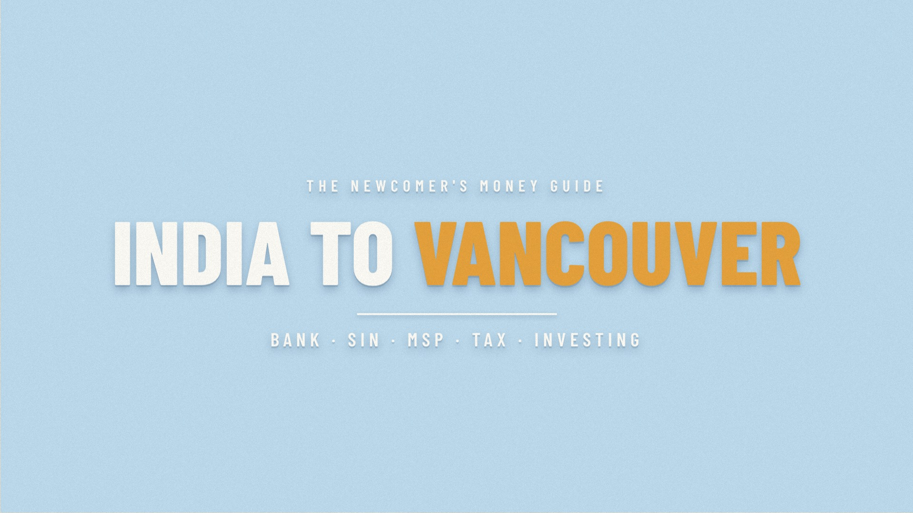

# Moving from India to Vancouver: the complete money guide

**▶ [Download the video (1080p, 14 min, 409 MB)](https://github.com/Tascano/transfervideo/raw/main/india-to-vancouver-1080p.mp4)**

**▶ [Download the vertical version for phones (9:16, 108 MB)](https://github.com/Tascano/transfervideo/raw/main/india-to-vancouver-vertical.mp4)**

On a phone, the file saves to Downloads (Files on iPhone) and plays in any video player.
English captions: [captions.srt](captions.srt).

Moving from Bangalore or Mumbai to Vancouver for a job? This guide goes from the very first step to the advanced ones, in order: opening a Canadian bank account from India and sending money before you fly (LRS, TCS, NRO repatriation), what to do at the airport, getting your SIN, MSP health cover and the 3-month wait, your first paycheque on a $120,000 salary, renting, your B.C. driver's licence, converting Indian accounts to NRO/NRE, mutual funds, EPF, NPS and gold as an NRI, Canada's landing-day cost reset, Form T1135, your first tax return, how to invest (emergency fund, employer match, TFSA, FHSA, RRSP), and life at work: a monthly budget, renting vs buying, big-tech benefits and RSUs (Amazon as the example), trips home (visitor visa, travel insurance), a family doctor, renewing your permit, a will and insurance. It ends with every step on one flowchart.

The example uses about ₹70 lakh of savings and investments and a $120,000 CAD job in Vancouver, B.C., on an employer-sponsored work permit. Figures are 2026 rules and rates; exchange rate about ₹68.6 per CAD (late August 2026). This is general information, not financial, tax or immigration advice: rules change, so check each source below for your own situation and talk to a cross-border (India–Canada) tax adviser before moving large amounts.

## Chapters

- 0:00 Intro
- 0:29 The journey and the plan
- 0:55 What you're moving
- 1:18 Before you fly
- 3:20 Your first weeks
- 5:20 Your money in India
- 7:17 Tax and investing in Canada
- 10:07 Life at work
- 13:02 Every step, in order

## Sources

- RBC, New to Canada: open an account before you arrive (India eligible; up to $75,000 in up to 3 wires; activate at a branch) — https://www.rbcroyalbank.com/new-to-canada/pre-arrival/
- Scotiabank StartRight: open an account online before you arrive — https://www.scotiabank.com/ca/en/personal/bank-accounts/newcomers-to-canada.html
- Service Canada, Apply for a SIN (online, in person or by mail; free; temporary SIN starts with 9) — https://www.canada.ca/en/employment-social-development/services/sin/apply.html
- Gov. of B.C., MSP coverage wait period (rest of the month + 2 months) — https://www2.gov.bc.ca/gov/content/health/health-drug-coverage/msp/bc-residents/eligibility-and-enrolment/how-to-enrol/coverage-wait-period
- Gov. of B.C., MSP eligibility (work permits valid 6+ months) — https://www2.gov.bc.ca/gov/content/health/health-drug-coverage/msp/bc-residents/eligibility-and-enrolment/are-you-eligible
- Gov. of B.C., Non-Photo BC Services Card (temporary immigration status: mailed by HIBC) — https://www2.gov.bc.ca/gov/content/governments/government-id/bc-services-card/types-of-cards/non-photo
- ICBC, Moving from outside Canada (90 days; knowledge and road tests for non-exchange countries; proof of 2+ years' experience) — https://icbc.com/driver-licensing/moving-bc/moving-from-another-country
- Gov. of B.C., Tenancy deposits and fees (max 1/2 month's rent; pet deposit 1/2) — https://www2.gov.bc.ca/gov/content/housing-tenancy/residential-tenancies/starting-a-tenancy/deposits-fees
- CBSA, Travelling with CAN$10,000 or more — https://www.cbsa-asfc.gc.ca/travel-voyage/ttd-vdd-eng.html
- Gov. of B.C., Personal income tax rates 2026 — https://www2.gov.bc.ca/gov/content/taxes/income-taxes/personal/tax-rates
- CRA, Current year tax rates and income brackets (2026) — https://www.canada.ca/en/revenue-agency/services/tax/individuals/tax-rates-brackets/current-year.html
- CRA, CPP and EI 2026 maximums (YMPE $74,600, YAMPE $85,000; EI 1.63% to $68,900) — https://www.canada.ca/en/revenue-agency/services/tax/registered-plans-administrators/pspa/mp-rrsp-dpsp-tfsa-limits-ympe.html
- CRA, Newcomers to Canada (residency starts on arrival; return due April 30) — https://www.canada.ca/en/revenue-agency/services/tax/international-non-residents/individuals-leaving-entering-canada-non-residents/newcomers-canada-immigrants.html
- CRA, Completing your return for newcomers (property deemed acquired at fair market value on arrival) — https://www.canada.ca/en/revenue-agency/services/tax/international-non-residents/individuals-leaving-entering-canada-non-residents/newcomers-canada-immigrants/completing-return-newcomers.html
- CRA, Questions and answers about Form T1135 (first-year exemption; $100,000 cost; personal-use property excluded) — https://www.canada.ca/en/revenue-agency/services/tax/international-non-residents/information-been-moved/foreign-reporting/questions-answers-about-form-t1135.html
- CRA, Calculate your TFSA contribution room ($7,000 for 2026; newcomers get the full year's limit, no earlier years; 1% a month on excess) — https://www.canada.ca/en/revenue-agency/services/tax/individuals/topics/tax-free-savings-account/contributing/calculate-room.html
- CRA, First Home Savings Account ($8,000 a year; $40,000 lifetime) — https://www.canada.ca/en/revenue-agency/services/tax/individuals/topics/first-home-savings-account.html
- CRA, RRSP deduction limit (18% of last year's earned income; $33,810 for 2026) — https://www.canada.ca/en/revenue-agency/services/tax/individuals/topics/rrsps-related-plans/contributing-a-rrsp-prpp/contributions-affect-your-rrsp-prpp-deduction-limit.html
- FCAC, Improving your credit score (use less than 30% of your limit) — https://www.canada.ca/en/financial-consumer-agency/services/credit-reports-score/improve-credit-score.html
- CDIC, deposit insurance up to $100,000 per category — https://www.cdic.ca/
- IRCC, Express Entry: Canadian Experience Class (1 year / 1,560 hours of skilled Canadian work in the last 3 years) — https://www.canada.ca/en/immigration-refugees-citizenship/services/immigrate-canada/express-entry/who-can-apply/canadian-experience-class.html
- WelcomeBC, BC Newcomer Services Program (temporary workers eligible) — https://www.welcomebc.ca/start-your-life-in-b-c/settlement-services
- CRA, Slam the scam (CRA never threatens arrest or asks for gift cards or crypto) — https://www.canada.ca/en/revenue-agency/campaigns/fraud-scams.html
- HealthLink BC, 8-1-1 — https://www.healthlinkbc.ca/
- RBI, Liberalised Remittance Scheme (US$250,000 per financial year) — https://www.rbi.org.in/
- Income Tax Act (India) s.206C(1G): TCS on LRS, 20% above ₹10 lakh for other purposes (Finance Act 2025/2026); not applicable to NRO remittances by NRIs — Kotak Mahindra Bank FAQ, https://www.kotak.bank.in/en/digital-banking/insta-services/send-money-abroad/faqs.html
- RBI / Kotak, NRO repatriation up to US$1 million per financial year with Forms 15CA/15CB — https://www.kotak.bank.in/en/stories-in-focus/nri/how-to-repatriate-money-from-nro-accounts-to-nre-overseas-accounts.html
- FEMA: resident accounts to be redesignated NRO on becoming non-resident — IDFC FIRST Bank, https://www.idfcfirst.bank.in/finfirst-blogs/nri/bank-account-changes-after-becoming-nri
- Income Tax Act (India) s.10(4)(ii): NRE interest exempt for non-residents
- Income Tax Act (India) s.6(1), Explanation 1: 182 days for Indian citizens leaving India for employment — Deloitte, https://www2.deloitte.com/content/dam/Deloitte/in/Documents/tax/in-tax-gbt-taking-up-employment-outside-india-05.04-noexp.pdf
- Zerodha Varsity, Can US/Canada NRIs invest in Indian mutual funds? — https://zerodha.com/z-connect/varsity/can-us-canada-nris-invest-in-indian-mutual-funds
- EPFO: inoperative accounts and withdrawals before 5 years taxable — Business Today, 28 July 2026, https://www.businesstoday.in/personal-finance/news/story/retired-migrated-or-unemployed-heres-when-your-epf-account-quietly-stops-earning-interest-545462-2026-07-28
- PFRDA: NPS for NRIs (account stays open; contribute via NRE/NRO) — https://www.pfrda.org.in/
- Exchange rate ≈ ₹68.6 per CAD, 28 August 2026 — https://30rates.com/cad-to-inr-today-forecast-canadian-dollar-to-rupee
- liv.rent, October 2026 Metro Vancouver rent report (Vancouver unfurnished 1-bedroom average $2,329) — https://liv.rent/blog/rent-reports/october-2026-metro-vancouver-rent-report/
- TransLink, Pricing and fare zones (adult 1-zone monthly pass $117.20 from 1 July 2026) — https://www.translink.ca/transit-fares/pricing-and-fare-zones
- CMHC: housing is affordable when it costs less than 30% of before-tax household income — https://www.cmhc-schl.gc.ca/
- Gov. of B.C., 2026 maximum allowable rent increase 2.3% — https://news.gov.bc.ca/releases/2025HMA0067-000786
- Prohibition on the Purchase of Residential Property by Non-Canadians Act, extended to 1 January 2027 (work-permit exceptions) — https://laws-lois.justice.gc.ca/eng/acts/P-26.82/
- About Amazon Canada, Employees and benefits (benefits begin on day one; group RRSP; disability; life; financial counselling and estate planning) — https://www.aboutamazon.ca/workplace/employees-and-benefits
- Amazon RSU vesting (commonly 5/15/40/40) and sign-on bonuses — Fearless Salary Negotiation, https://fearlesssalarynegotiation.com/amazon-salary-negotiation/ (your offer letter governs)
- Baker McKenzie Global Equity Matrix, Canada: restricted stock units (taxed as employment income on vesting) — https://resourcehub.bakermckenzie.com/en/resources/global-equity-matrix/north-america/canada/topics/rsrsu
- IRCC, Travelling outside Canada and re-entering (a work permit is not a travel document; renewing the permit doesn't renew the visa) — https://www.canada.ca/en/immigration-refugees-citizenship/services/work-canada/extend/travel-outside-canada.html
- Gov. of B.C., Medical benefits outside of B.C. (hospital $75/day; buy travel insurance) — https://www2.gov.bc.ca/gov/content/health/health-drug-coverage/msp/bc-residents/benefits/services-covered-by-msp/medical-benefits/medical-benefits-outside-of-british-columbia
- HealthLink BC, Health Connect Registry — https://www.healthlinkbc.ca/find-care/health-connect-registry
- IRCC, Extend your work permit (apply at least 30 days before expiry; maintained status) — https://www.canada.ca/en/immigration-refugees-citizenship/services/work-canada/extend/apply.html

Images: AI illustration. Map data: Natural Earth (public domain).
